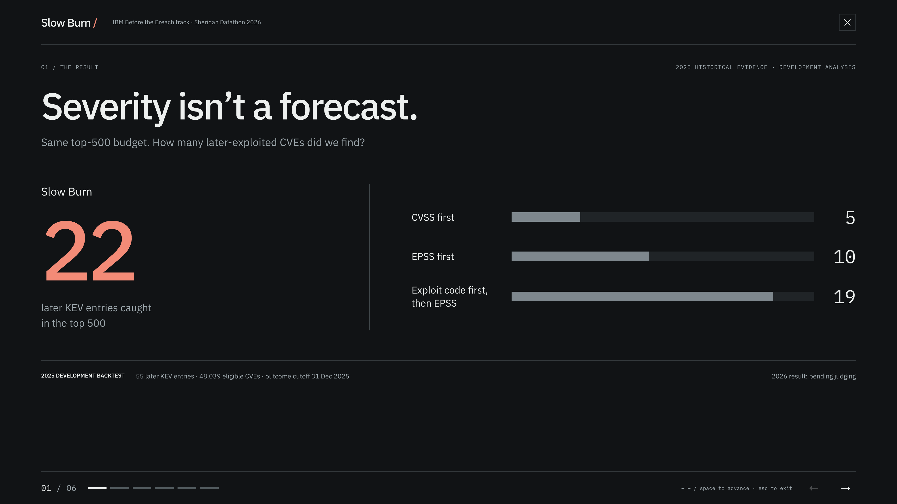
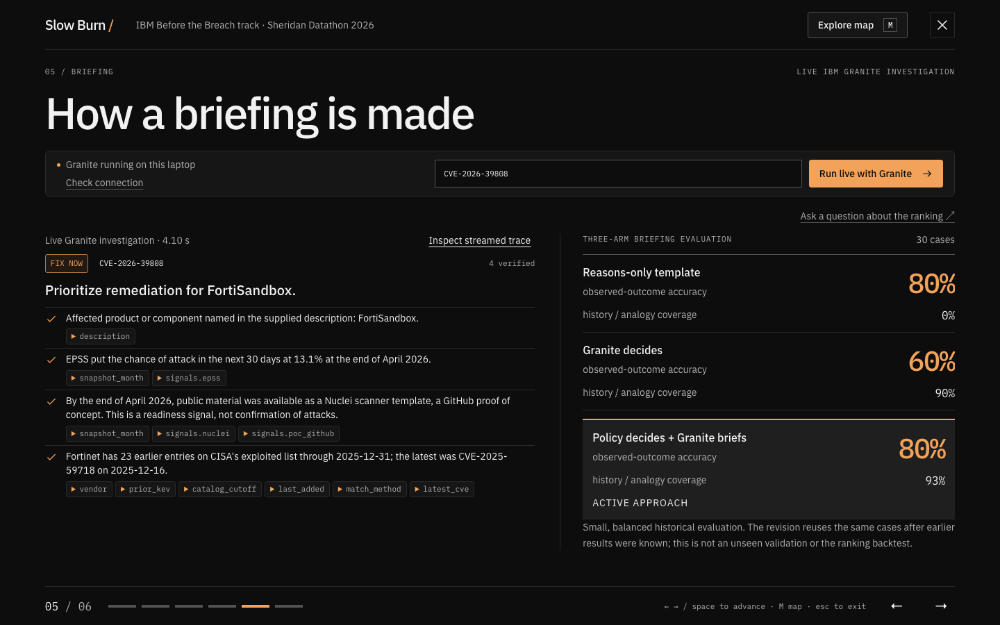
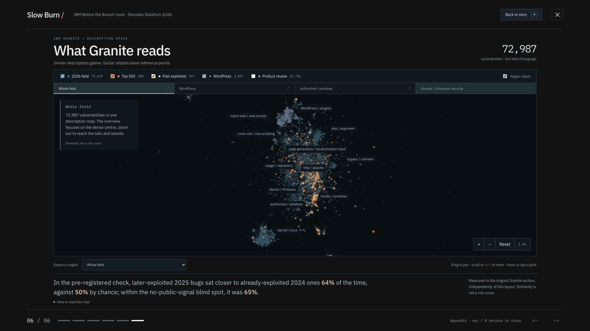

# Slow Burn

Slow Burn ranks newly published vulnerabilities by likelihood of later exploitation. IBM Granite prepares a briefing for each CVE from checked tool results. CVSS scores describe potential attack severity.

Built in 24 hours for the IBM **Before the Breach** track at Sheridan Datathon 2026.

**Live page: [aly700.github.io/slow-burn](https://aly700.github.io/slow-burn/)** (press `p` for the presentation). Live Granite investigation runs when the agent API is running on the same machine; otherwise the page replays recorded runs and says so.


## What we found

Tested on 2025 the same way the track's benchmark works (train on 2024; rank each vulnerability using only what was known at the end of its publish month; count the ones CISA later added to its Known Exploited Vulnerabilities list):

| Ranking | Later-exploited found in the top 500 (of 55) |
| :-- | --: |
| Highest CVSS first | 5 |
| EPSS first | 10 |
| Public exploit code first, then EPSS | 19 |
| **Slow Burn** | **22** |

- **KEV listing delays.** Of the 165 vulnerabilities published in 2025 that CISA listed as exploited, 110 were listed within their first month. The other 55 took a median of 45 days from publication to listing.
- **No public exploit signal.** 31 of those 55 had no public exploit code at the time, so rankings built on exploit feeds can't see most of them. We tried to close it and could not: EPSS put none of the 31 in its top 500, and neither did a model trained only on that pool, whose design was fixed and committed before it was tested on 2025. One thing did mark them: 15 of the 31 hit a product that was already on the exploited list, against 16% of the pool they came from. Vendor-wide history, which helps inside the exploit tier, made no difference here. Product history can support an asset review; the dedicated model did not improve ranking within this pool. The [exploratory 2026 watch list](artifacts/watch_2026_top100.csv) is kept separate from the submission.
- **Description similarity.** Using only IBM Granite Embedding's reading of the descriptions, a 2025 vulnerability that was later exploited sat closer to an already-exploited 2024 one than a non-exploited 2025 vulnerability did 64% of the time, against 50% by chance (permutation p = 0.0003). Inside the blind spot it was 65% (p = 0.002). The test and its pass mark were written down in `pipeline/MAP_PLAN.md` before the distances were computed. It's an association, too weak on its own to fill a 500-row list, which is why the watch model still found none, but together with product history it's one of only two signals we found that reach the blind spot at all. The [live page](https://aly700.github.io/slow-burn/) draws the whole 2026 pool as a map.
- **Earlier vendor exploitation.** Among vulnerabilities with public exploit code, vendors with 20 or more earlier KEV entries were later listed 4.35% of the time, against 1.19% for vendors with none.
- **WordPress plugins** were about 9% of all 2025 vulnerabilities, and none was later added to the list.

The 2026 result is scored by the organisers after submission.



## How it works

**`pipeline/` (the ranking).** LightGBM keeps the strongest simple rule (public exploit code first) and decides the order inside it from snapshot EPSS, exploit flags, the vendor's earlier KEV history and IBM Granite Embedding 30M embeddings of the description. Explicit exploitation wording is stripped from descriptions before any text feature. Columns that reflect analysis done after an attack (NVD status, product and reference counts, blank scores, news links) are excluded; `pipeline/leak_audit.py` measures how much each one would have inflated the backtest. Two forward splits, a month bootstrap and five-seed refits back the choice. Output: `artifacts/top500.csv`.

**`agent/` (the fix-first briefing).** IBM Granite 4.0 H Small runs locally through MLX, with no network access. For any of the 72,670 benchmark CVEs it chooses which read-only MCP tools to call (details, exploit signals over time, vendor KEV history, the most similar past exploited vulnerabilities by Granite embeddings), then picks the facts, headline and action from options built from what the tools returned. A deterministic verifier drops any claim that does not match a tool value. `GET /live/{cve}` streams each step to the page (median about 2 s); `GET /ask` answers questions about the ranking under the same checks and refuses rather than guesses. The ranking sets priority, because on 30 held-out cases Granite deciding alone was right 60% of the time against 80% for the policy. The only write action, filing a ticket, is refused by the server unless a human approved that exact briefing. Red team: across 80 prompt-injection attacks, no ticket was filed without approval and no priority changed; on 32 fresh attacks frozen before the hardening, planted wording still reached briefing text in 4 (details in `artifacts/redteam_eval.json`).

**`web/` (the page).** A static React page: the 2025 replay, the findings, a fix-first queue you can filter to the vendors and products you run (with the previously-attacked-products list and CSV or ticket JSON export), live Granite investigation, the analyst, and the Granite map of all 2026 descriptions. Press `p` for the six-slide presentation and `m` for the map.





## Run it

The track data is not redistributed here. Put the organisers' `data/` folder (from `data.zip`) at the repo root.

```sh
# ranking and every artifact
uv run python -I pipeline/run.py --all

# agent: build the embedding index, record briefings, run the API on :8765
uv run --project agent python -m agent.prepare --embeddings
uv run --project agent python -m agent.record --top 15
uv run --project agent python -m agent.api

# page on :4317
cd web && npm ci && npm run build && npx vite preview --port 4317 --strictPort
```

Each part has its own README with details: [pipeline](pipeline/README.md), [agent](agent/README.md), [web](web/README.md). The artifact contracts between them are in [research/CONTRACTS.md](research/CONTRACTS.md).

## Data

Only the datasets provided for the IBM track (NIST NVD, CISA KEV to 2025-12-31, EPSS and public exploit flags by month, MITRE CWE). No outside data.
